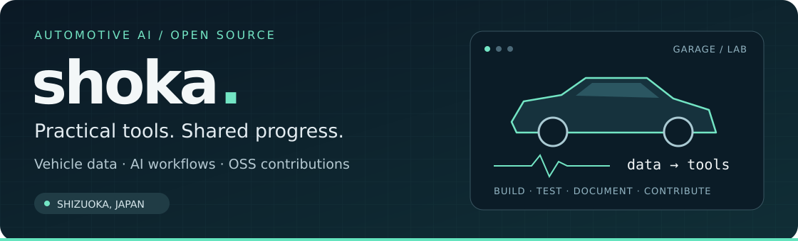
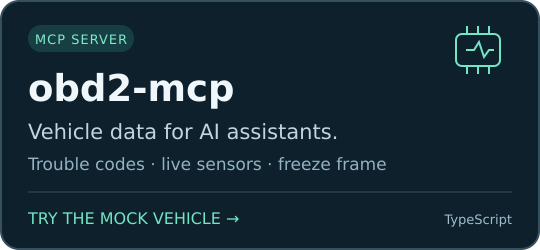
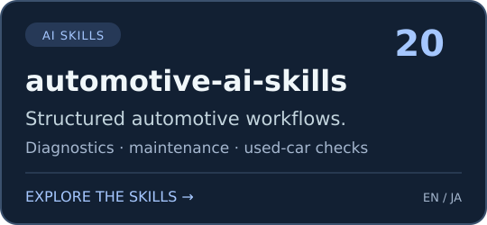

  <a href="https://shoka-jp.github.io/automotive-ai-skills/tools/vehicle-brief.html?vehicle=nbox&amp;task=buy"><b>N-BOX buying check</b></a> ·
  <a href="https://shoka-jp.github.io/automotive-ai-skills/tools/obd2-preview.html"><b>OBD-II browser demo</b></a> ·
  <a href="#contribute"><b>Contribute / 参加</b></a> ·
  <a href="#open-source-contributions"><b>OSS contributions</b></a> ·
  <a href="https://qiita.com/shoka-jp"><b>Qiita</b></a> ·
  <a href="https://github.com/sponsors/shoka-jp"><b>Sponsor</b></a>

I'm **shoka**, a software engineer in Shizuoka, Japan. I build tools that connect **vehicle data and AI**, and contribute focused documentation improvements to open source.

静岡を拠点に、**自動車 × AIのツール開発**と、**OSSのドキュメント改善**に取り組んでいます。

## What I'm building

**[obd2-mcp](https://github.com/shoka-jp/obd2-mcp)** connects MCP clients to OBD-II trouble codes, live sensors, and freeze-frame data. The included mock vehicle lets you try the tools **without a car or adapter**.

**[automotive-ai-skills](https://github.com/shoka-jp/automotive-ai-skills)** provides **20 structured AI workflows** for diagnostics, maintenance, used-car inspection, and more, with English and Japanese documentation.

### Contribute

Questions, translations, documentation and code are welcome. Selected tasks use simulated data and need no car. 車やプログラミング経験がなくても、感想や説明の改善で参加できます。

- **Automotive AI Skills:** [first tasks](https://github.com/shoka-jp/automotive-ai-skills/contribute) · [share a question or first-use feedback](https://github.com/shoka-jp/automotive-ai-skills/issues/new?template=first-experience.yml)
- **obd2-mcp:** [first tasks](https://github.com/shoka-jp/obd2-mcp/contribute) · [share a question or first-use feedback](https://github.com/shoka-jp/obd2-mcp/issues/new?template=first-experience.yml)

Feedback opens a public GitHub issue and requires an account. Please leave out VINs and personal information. 感想は公開されるため、車台番号や個人情報は記入しないでください。

### See it work

**Buying a used N-BOX?** [Try the vehicle brief builder](https://shoka-jp.github.io/automotive-ai-skills/tools/vehicle-brief.html?vehicle=nbox&task=buy) to organize questions and check references before a viewing. No sign-up or diagnostic hardware is required. The builder does not perform a diagnosis or determine recall eligibility.

**N-BOXの中古車選びに：** [車種別チェックメーカーを試す](https://shoka-jp.github.io/automotive-ai-skills/tools/vehicle-brief.ja.html?vehicle=nbox&task=buy)。現車確認の質問や資料を整理できます。登録・診断機は不要です。

The [reproducible mock demo](https://github.com/shoka-jp/obd2-mcp/blob/main/docs/demo-results.md) reads a stored **P0420**, its freeze frame, and current sensor values. It includes observed program output and a script you can run without an AI subscription. All data in that demo is simulated.

→ **[Explore the browser demo — no installation](https://shoka-jp.github.io/automotive-ai-skills/tools/obd2-preview.html)** · **[ブラウザーで模擬データを見る（日本語・インストール不要）](https://shoka-jp.github.io/automotive-ai-skills/tools/obd2-preview.ja.html)** · **[Run the demo from source / 実行結果と試し方](https://github.com/shoka-jp/obd2-mcp/blob/main/docs/demo-results.md)**

## Open-source contributions

I work on small, verifiable improvements: understanding the issue, checking for existing work, and validating the change.

| Project | Contribution | Status checked 2026-11-03 |
| --- | --- | --- |
| **VS Code documentation** | [Settings UX wording — #10552](https://github.com/microsoft/vscode-docs/pull/10552) · [Screenshot alt text — #10569](https://github.com/microsoft/vscode-docs/pull/10569) | **Both merged** |
| **pytest** | [Documented platform-conditional warning filters, with a tested example — #15274](https://github.com/pytest-dev/pytest/pull/15274) | **Open PR · not yet merged** |
| **MCP server catalog** | [obd2-mcp is listed in MCPHQ’s catalog](https://github.com/mcpHQ/awesome-mcp-servers/blob/main/README.md) · [PR #602](https://github.com/mcpHQ/awesome-mcp-servers/pull/602) | **Merged** |

These are individual contributions, not maintainer roles. See the linked PRs for current status, validation details, and disclosed AI assistance.

[All VS Code docs PRs](https://github.com/microsoft/vscode-docs/pulls?q=is%3Apr+author%3Ashoka-jp) · [All pytest PRs](https://github.com/pytest-dev/pytest/pulls?q=is%3Apr+author%3Ashoka-jp)

## Follow the work · Support the projects

**Follow [@shoka-jp](https://github.com/shoka-jp)** for automotive AI tools, practical examples, and open-source improvements. Tried a project? Reproducible feedback, documentation fixes, and translations are welcome.

If the projects are useful to you, **[sponsor my open-source work](https://github.com/sponsors/shoka-jp)**. Support helps me work on maintenance, examples, and clearer documentation. [Read about the projects you support →](./SPONSORING.md)

## 日本語

- **作っているもの：** [obd2-mcp](https://github.com/shoka-jp/obd2-mcp/blob/main/README.ja.md)で車両データをAIにつなぎ、[automotive-ai-skills](https://github.com/shoka-jp/automotive-ai-skills/blob/main/README.ja.md)で診断・整備・中古車チェックなどの対話を整理しています。
- **OSSへの貢献：** VS Codeの設定ガイド・画像代替テキスト修正と、MCPHQのサーバーカタログへのobd2-mcp掲載が採用済みです。pytestの警告フィルター説明は提案中です（2026-11-03確認、未マージ）。
- **まず試す：** [インストール不要の模擬データ体験](https://shoka-jp.github.io/automotive-ai-skills/tools/obd2-preview.ja.html)。実車を扱う前に、各プロジェクトの安全上の注意と制約も確認してください。
- **活動を応援：** フォロー、使ってみた感想、翻訳・説明の修正を歓迎します。[スポンサーによるご支援](https://github.com/sponsors/shoka-jp)も受け付けています。

[Qiitaの技術メモ](https://qiita.com/shoka-jp)
