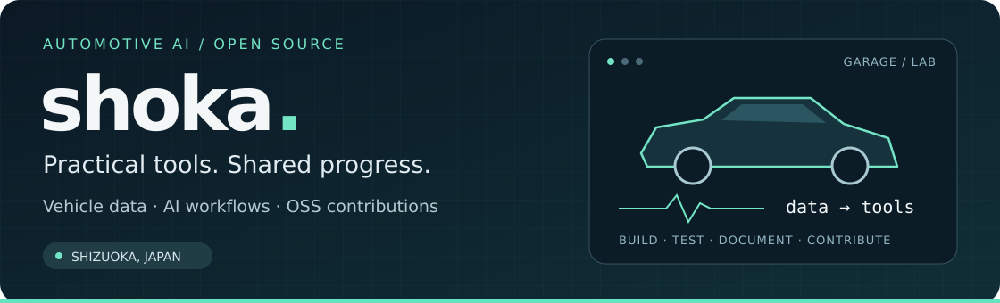
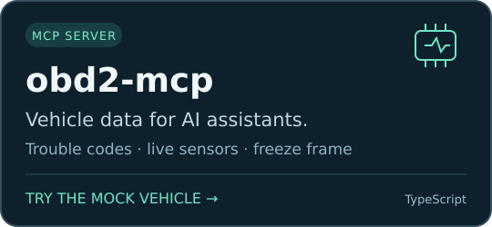
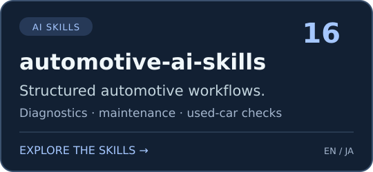

  <a href="https://github.com/shoka-jp/obd2-mcp/blob/main/docs/demo-results.md"><b>Try a demo</b></a> ·
  <a href="#open-source-contributions"><b>OSS contributions</b></a> ·
  <a href="https://qiita.com/shoka-jp"><b>Qiita</b></a> ·
  <a href="https://github.com/sponsors/shoka-jp"><b>Sponsor</b></a>

I'm **shoka**, a software engineer in Shizuoka, Japan. I build tools that connect **vehicle data and AI**, and contribute focused documentation improvements to open source.

静岡を拠点に、**自動車 × AIのツール開発**と、**OSSのドキュメント改善**に取り組んでいます。

## What I'm building

**[obd2-mcp](https://github.com/shoka-jp/obd2-mcp)** connects MCP clients to OBD-II trouble codes, live sensors, and freeze-frame data. The included mock vehicle lets you try the tools **without a car or adapter**.

**[automotive-ai-skills](https://github.com/shoka-jp/automotive-ai-skills)** provides **16 structured AI workflows** for diagnostics, maintenance, used-car inspection, and more, with English and Japanese documentation.

### See it work

The [reproducible mock demo](https://github.com/shoka-jp/obd2-mcp/blob/main/docs/demo-results.md) reads a stored **P0420**, its freeze frame, and current sensor values. It includes observed program output and a script you can run without an AI subscription. All data in that demo is simulated.

→ **[Run the demo / 実行結果と試し方](https://github.com/shoka-jp/obd2-mcp/blob/main/docs/demo-results.md)**

## Open-source contributions

I work on small, verifiable improvements: understanding the issue, checking for existing work, and validating the change.

| Project | Contribution | Status checked 2026-10-29 |
| --- | --- | --- |
| **VS Code documentation** | [Corrected wording in the settings UX guidelines — #10552](https://github.com/microsoft/vscode-docs/pull/10552) | **Merged** |
| **pytest** | [Documented platform-conditional warning filters, with a tested example — #15274](https://github.com/pytest-dev/pytest/pull/15274) | **Open PR · not yet merged** |

These are individual contributions, not maintainer roles. See the linked PRs for current status, validation details, and disclosed AI assistance.

[All VS Code docs PRs](https://github.com/microsoft/vscode-docs/pulls?q=is%3Apr+author%3Ashoka-jp) · [All pytest PRs](https://github.com/pytest-dev/pytest/pulls?q=is%3Apr+author%3Ashoka-jp)

## Follow the work · Support the projects

**Follow [@shoka-jp](https://github.com/shoka-jp)** for automotive AI tools, practical examples, and open-source improvements. Tried a project? Reproducible feedback, documentation fixes, and translations are welcome.

If the projects are useful to you, **[sponsor my open-source work](https://github.com/sponsors/shoka-jp)**. Support helps me work on maintenance, examples, and clearer documentation. [Read about the projects you support →](./SPONSORING.md)

## 日本語

- **作っているもの：** [obd2-mcp](https://github.com/shoka-jp/obd2-mcp/blob/main/README.ja.md)で車両データをAIにつなぎ、[automotive-ai-skills](https://github.com/shoka-jp/automotive-ai-skills/blob/main/README.ja.md)で診断・整備・中古車チェックなどの対話を整理しています。
- **OSSへの貢献：** VS Codeの設定ガイド修正はマージ済み。pytestには、条件付き警告フィルターの説明を提案しています（2026-10-29確認、未マージ）。
- **まず試す：** [車・アダプタ・AIの契約なしで試せるモックデモ](https://github.com/shoka-jp/obd2-mcp/blob/main/docs/demo-results.md)。実車を扱う前に、各プロジェクトの安全上の注意と制約も確認してください。
- **活動を応援：** フォロー、使ってみた感想、翻訳・説明の修正を歓迎します。[スポンサーによるご支援](https://github.com/sponsors/shoka-jp)も受け付けています。

[Qiitaの技術メモ](https://qiita.com/shoka-jp)
